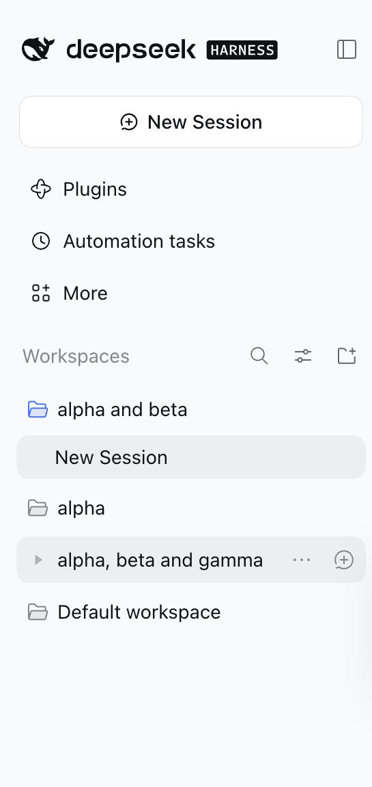

# dsh-multi-workspace

**One workspace. Many folders.**

Pick several project folders in one picker — the native macOS panel on a local desktop, or the
plugin's in-app browser on the Web — and DeepSeek Harness treats them as one workspace: every
folder becomes a symlink inside a real directory under `~/.dsh/multi-workspaces/`, so one session
can read, edit, and run commands across all of them.



## What you get

- **Multi-select everywhere.** Both "Add workspace" entry points — the sidebar folder-plus action
  and the prompt-above **Choose workspace → Add workspace…** menu — let you select several folders
  at once: a normal macOS folder panel on a local desktop, or the plugin's in-app browser in the Web
  profile.
- **Web profile ready.** The in-app browser lists the Host's directories over its own Remote, so a
  remote Linux host with no display can still pick folders from your browser. Nothing opens on the
  host's screen.
- **One workspace, all folders.** The workspace is a real directory whose entries are symlinks to
  your folders, so `alpha/` and `beta/` sit side by side in the same session.
- **Edit the member list later.** A combined workspace's **⋯** menu gains **Add folders…** and
  **Remove folders…** beside the shipped Rename and Delete rows. Adding uses the same picker;
  removing lists the members and refuses to go below two folders. Only links change — the folders
  on disk are never touched.
- **Stable identity, honest name.** The real directory is named after a time-ordered (v7) UUID, so
  it never changes when the member list does and `ls` stays in creation order. The sidebar title is
  still derived from the folders — `alpha and beta`, `alpha, beta and gamma` — and is recomputed
  automatically after an edit. A title you renamed yourself is left alone.
- **Single folder stays stock.** Pick one folder and nothing special happens: it opens directly,
  exactly like the built-in picker.
- **Nothing is moved, copied, or deleted.** Only symlinks are created; removing the workspace or a
  member never touches your folders.

## Install

Built artifacts are committed, so install straight from GitHub:

```bash
dsh plugin --profile desktop add github:rn7s2/dsh-multi-workspace
# use --profile web for `dsh web`
```

Restart the app once afterwards. For a local development checkout:

```bash
git clone https://github.com/rn7s2/dsh-multi-workspace.git
cd dsh-multi-workspace && pnpm install && pnpm build
dsh plugin --profile desktop add "$PWD"
```

Requires DeepSeek Harness **0.2.1-rc.3+**. On a local macOS desktop the picker is the native folder
panel; in the Web profile it is the plugin's in-app browser, so remote Linux hosts work too.

> Troubleshooting: if the "Add workspace" button disappears, the bundle was installed without its
> committed `lib/` artifacts. Reinstall with the commands above and restart.

## Tool caveats in combined workspaces

The root is a directory of symlinks, not a Git repository. The plugin injects a short per-session
note for combined workspaces; the essentials:

- **Worktrees** — don't call `create_worktree` at the root. Use
  `working_directory({ cd: "<member>" })` first and then `create_worktree`, or
  `git -C <member> worktree add <member>/.agents/worktrees/<name> -b <branch>`. Never create sibling
  worktree directories.
- **grep / glob** — search a member path explicitly, or use `bash` + `rg --follow`; a search started
  at the root skips the symlinked members.
- **read / edit / write / bash** — follow the symlinks and work on the real folders.
- **`workspace-write`** — member folders are outside the sandbox root, so writes there are denied.
  Switching the session to Full access fixes it; when a write is denied the model mentions it once,
  does not block the task, and continues with permitted work.

## Details

- Workspaces live under `~/.dsh/multi-workspaces/<uuid-v7>`; each contains a hidden
  `.dsh-multi-workspace.json` recording its id, title, whether that title is automatic, and its
  links. Manifests written before this identity change are still read: the directory name is taken
  as the id and the title is treated as derived.
- Picking exactly the folders that an existing directory already holds reuses that directory instead
  of allocating a second one — including a directory whose workspace was deleted, provided that
  workspace never owned a session.
- Deleting a workspace is careful: only the links named by the manifest and the manifest itself are
  removed, then the directory is dropped once it is empty. A file you put in there — or a member
  entry that is no longer a link — keeps the directory alive, and it is adopted again if the same
  folders are picked later. A workspace that ever owned a session keeps its directory too, because
  those sessions hold that path as their recorded cwd.
- The removal dialog marks members a running session is working in, and warns before removing them.
- A title renamed through the shipped dialog is written back into the manifest, so a later add or
  remove cannot undo it. Two workspaces that would derive the same title get ` (2)`, ` (3)`, … and
  keep updating as folders change.
- The Workspace menu rows are an addition, not a requirement: a harness without the context-menu
  service still loads this plugin and keeps creating workspaces.
- Override the root with the plugin row's `config.rootDir` (absolute path).
- Duplicate folder names get `-2`, `-3`, … on the symlink; the display title keeps the plain
  folder names.
- In the Web dialog, one selected folder opens directly; two or more create the combined workspace.
  Hidden folders are shown on demand, and directory levels are bounded by the Host.

## Development

```bash
pnpm run typecheck && pnpm run test && pnpm run build
```

`lib/` is committed because GitHub installs do not run a build — rebuild and commit it with every
source change. See [dev/](dev/) for an isolated end-to-end instance.

## License

MIT.
