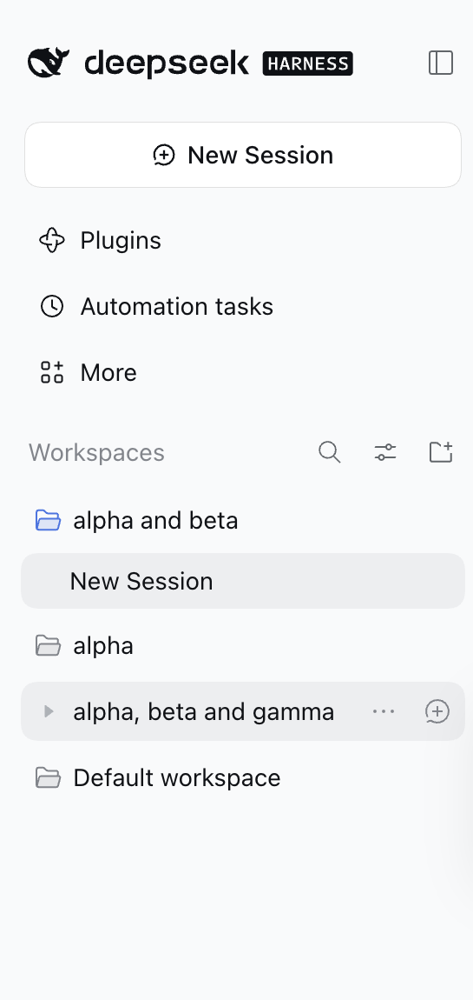

# dsh-multi-workspace

**One workspace. Many folders.**

Pick several project folders in a single native macOS dialog and DeepSeek Harness treats them as
one workspace: every folder becomes a symlink inside a real directory under
`~/.dsh/multi-workspaces/`, so one session can read, edit, and run commands across all of them.



## What you get

- **Native multi-select.** Both "Add workspace" entry points — the sidebar folder-plus action and
  the prompt-above **Choose workspace → Add workspace…** menu — open a normal macOS folder panel
  where you can select several folders at once.
- **One workspace, all folders.** The workspace is a real directory whose entries are symlinks to
  your folders, so `alpha/` and `beta/` sit side by side in the same session.
- **Hands-off naming.** Workspaces are named after your folders: `alpha`, `alpha and beta`,
  `alpha, beta and gamma`; the real directory gets a tidy ASCII slug such as `alpha-beta`.
- **Single folder stays stock.** Pick one folder and nothing special happens: it opens directly,
  exactly like the built-in picker.
- **Nothing is moved, copied, or deleted.** Only symlinks are created; removing the workspace
  never touches your folders.

## Install

Built artifacts are committed, so install straight from GitHub:

```bash
dsh plugin --profile desktop add github:rn7s2/dsh-multi-workspace
# use --profile web for `dsh web`
```

Restart the app once afterwards. For a local development checkout:

```bash
git clone https://github.com/rn7s2/dsh-multi-workspace.git
cd dsh-multi-workspace && pnpm install && pnpm build
dsh plugin --profile desktop add "$PWD"
```

Requires **macOS** and DeepSeek Harness **0.2.1-rc.3+**. The picker is the native macOS panel;
other platforms are not supported yet.

> Troubleshooting: if the "Add workspace" button disappears, the bundle was installed without its
> committed `lib/` artifacts. Reinstall with the commands above and restart.

## Tool caveats in combined workspaces

The root is a directory of symlinks, not a Git repository. The plugin injects a short per-session
note for combined workspaces; the essentials:

- **Worktrees** — don't call `create_worktree` at the root. Use
  `working_directory({ cd: "<member>" })` first and then `create_worktree`, or
  `git -C <member> worktree add <member>/.agents/worktrees/<name> -b <branch>`. Never create sibling
  worktree directories.
- **grep / glob** — search a member path explicitly, or use `bash` + `rg --follow`; a search started
  at the root skips the symlinked members.
- **read / edit / write / bash** — follow the symlinks and work on the real folders.
- **`workspace-write`** — member folders are outside the sandbox root, so writes there are denied.
  Switching the session to Full access fixes it; when a write is denied the model mentions it once,
  does not block the task, and continues with permitted work.

## Details

- Workspaces live under `~/.dsh/multi-workspaces/<slug>`; each contains a hidden
  `.dsh-multi-workspace.json` describing its links.
- Override the root with the plugin row's `config.rootDir` (absolute path).
- Duplicate folder names get `-2`, `-3`, … on the symlink; the display title keeps the plain
  folder names.

## Development

```bash
pnpm run typecheck && pnpm run test && pnpm run build
```

`lib/` is committed because GitHub installs do not run a build — rebuild and commit it with every
source change. See [dev/](dev/) for an isolated rc.3 end-to-end instance.

## License

MIT.
